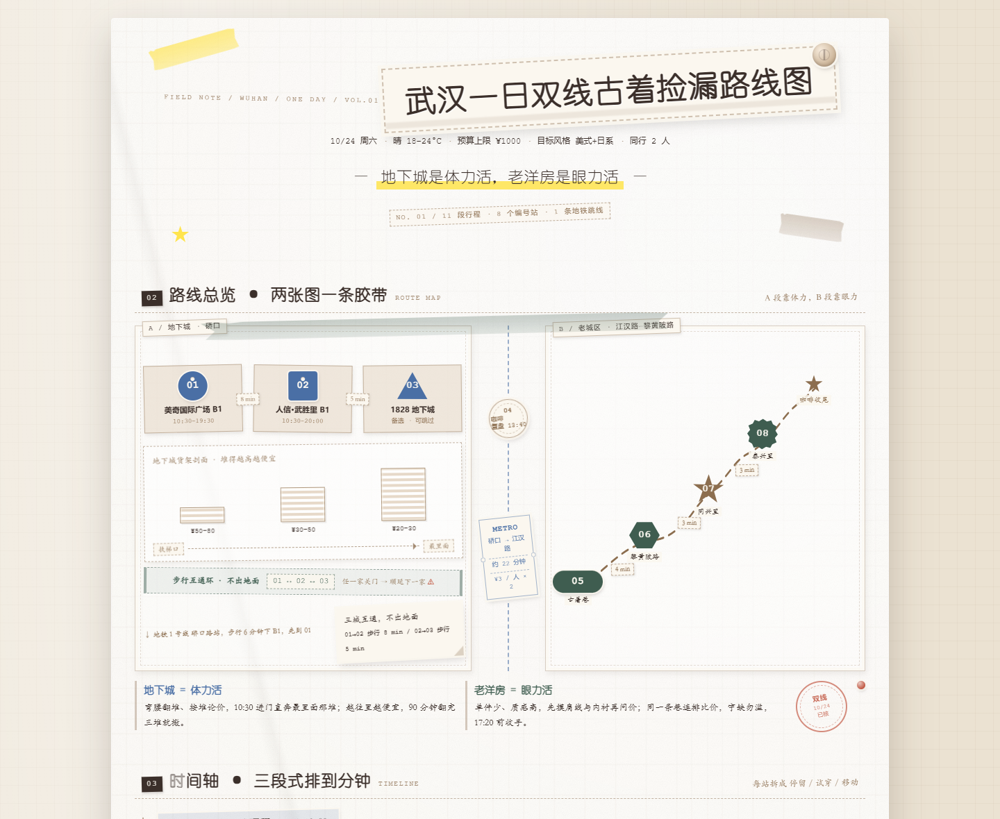

# 武汉一日双线 · 古着捡漏作战手账

> 手账贴纸风的武汉古着店捡漏路线规划页：一天双线 8 站，缝线路线串起地下城翻货与老洋房挑货，含尺码成色、砍价守则、预算小票与可勾选清单，一份照着就能出门的买手手账。

**在线预览 → https://lucapogg.github.io/wuhan-vintage-route/**  
（手机可直接打开；或 `Ctrl/⌘+P` 存成 PDF）



---

## 这是什么

不是探店合集，是一页 **"买手视角"** 的古着捡漏作战手账。

它把武汉古着最集中的两个片区——**硚口地下城** 与 **黎黄陂路老洋房**——用一条缝线串成一条一日双线：

> **地下城是体力活，老洋房是眼力活。**
> 同一天，练两种捡漏手感。

| 片区 | 淘货技能 | 关键词 |
|---|---|---|
| 硚口地下城 | **体力活** | 弯腰翻堆、按堆论价、越往里越便宜 |
| 老洋房片区 | **眼力活** | 单件少质感高、先摸肩线与内衬再问价 |

页面里每一站都写清了：价位带、心理价、验货雷区、砍价节奏、出片角度、人流时段；
外加可勾选的九类捡漏清单、成色 A/B/C 分级、地下市场专属验货 6 项、预算小票与停手线。
**照着就能出门。**

## 页面结构（9 个区块）

| # | 区块 | 内容 |
|---|---|---|
| 01 | 标题区 | 主标题贴纸 · 日期天气预算 · 核心概念标语 |
| 02 | 路线总览 | 两张手绘小图用一条和纸胶带拼起来（地下城货架剖面 + 老城街道线），中间一段地铁跳线 |
| 03 | 时间轴 | 上午 / 中午 / 下午三段，每站拆「停留 / 试穿 / 移动」三段时间 |
| 04 | 八张店铺便签 | 一家一条命：编号吊牌 + 风格标签 + 价位 + 心理价 + 捡漏信号 + 验货重点 + 出片角度 + 拍立得 + 印章 |
| 05 | 九类捡漏清单 | ☐ 尺码 · 心理价 · 成色 A/B/C · 瑕疵记录位，附分级说明与验货 6 项 |
| 06 | 预算小票 | 交通/餐饮/改衣/购物/其他，逐项明细 + 合计 ≤¥672 + 停手线 ¥600 |
| 07 | 战利品记录 | 四格拍立得 · 价格吊牌 · 店铺印章 · "为什么值得买" |
| 08 | 砍价与注意 | 先问价再试穿 · 必检 7 处 · 退换消毒 · 议价节奏 · 改衣提醒 · 心态提醒 |
| 09 | 备选与应急 | 24h 自助古着 / 硚口顺延方案 + 收尾贴纸 |

## 视觉语言

手账贴纸风，但核心不是"可爱"，是 **"证据感"**——像这本手账真的被用了一天：

- 纸：奶油网格 / 牛皮纸 / 折痕 / 压痕 / 撕边胶带
- 贴纸：白描边 + 柔和投影 + 随机倾斜（−4°~+4°），每个元素都错落叠贴
- 手写痕迹：红笔圈注、荧光笔划线、缝线针脚箭头、图钉、回形针
- 材质：拍立得白框、橡皮章、票根小票、吊牌编号、便利贴、牛仔布贴片
- 配色：奶油白 `#FBF7EF` / 低饱和棕 `#8C6E4F` / 牛仔蓝 `#4A6FA5` / 墨绿 `#3F5D50` + 荧光黄 `#FFE44D` 重点标记 + 砖红 `#C0523C` 避雷

## 怎么用

**方式一**：直接双击 `index.html`，用浏览器打开即可。

**方式二**：起一个本地静态服务器（推荐，移动端调试更顺）：

```bash
python -m http.server 8000
# 然后访问 http://localhost:8000
```

**方式三**：按 `Ctrl` / `⌘` + `P` 打印或存成 PDF —— 页面内置了 A4 打印样式，分区不会被切断。

## 技术说明

- **单文件**：`index.html` 一个文件搞定，CSS 与 JS 全部内联
- **零外部依赖**：无外链字体、无 CDN、无网络图片（纸纹是内联 SVG turbulence），断网也能开
- **响应式**：320 / 375 / 414 / 768 / 1024 / 1440 / 1920 均无横向滚动；桌面三列、移动单列
- **可访问性**：15 个勾选框带 `aria-checked` 与可聚焦属性，支持 Tab 聚焦、Enter / Space 切换
- **降级**：尊重 `prefers-reduced-motion`，关闭动效

## 目录结构

```
wuhan-vintage-route/
├── index.html                    # 主体页面（单文件，CSS/JS 内联）
├── assets/
│   ├── preview.png               # 桌面首屏预览
│   ├── preview-mobile.png        # 移动端预览
│   └── preview-checklist.png     # 捡漏清单区特写
├── README.md
└── LICENSE
```

## 说明

- 页面中的**店名做泛称处理**（如"B1 日牌堆头""江汉路 古着巷"），但**商圈、商场、楼层写实名**，
  目的是让读者搜得到位置、同时避免过期信息被打假。
- 站内价格、营业时间、步行距离均为整理自公开信息与实操经验整理的参考值，
  **出行前请以实际店铺公示为准**。
- 页面不含任何品牌 Logo、二维码、水印与购买入口。

## License

[MIT](LICENSE)
